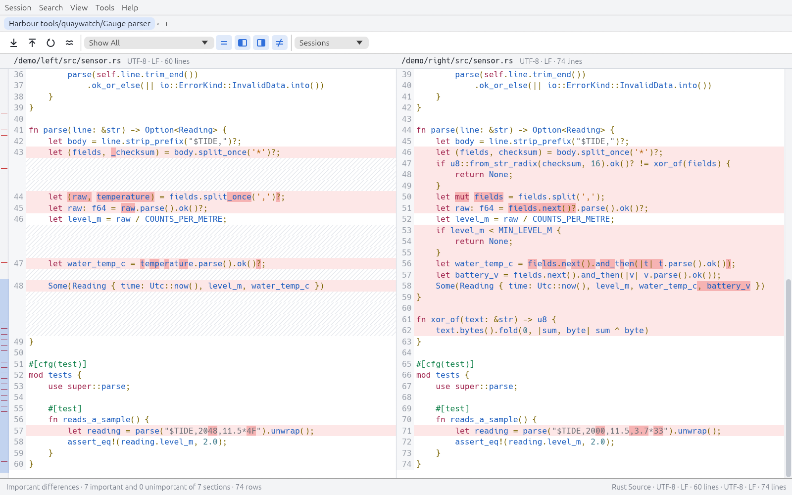
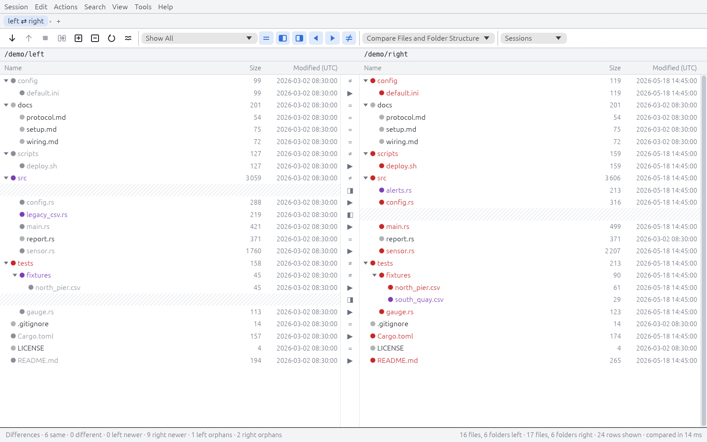
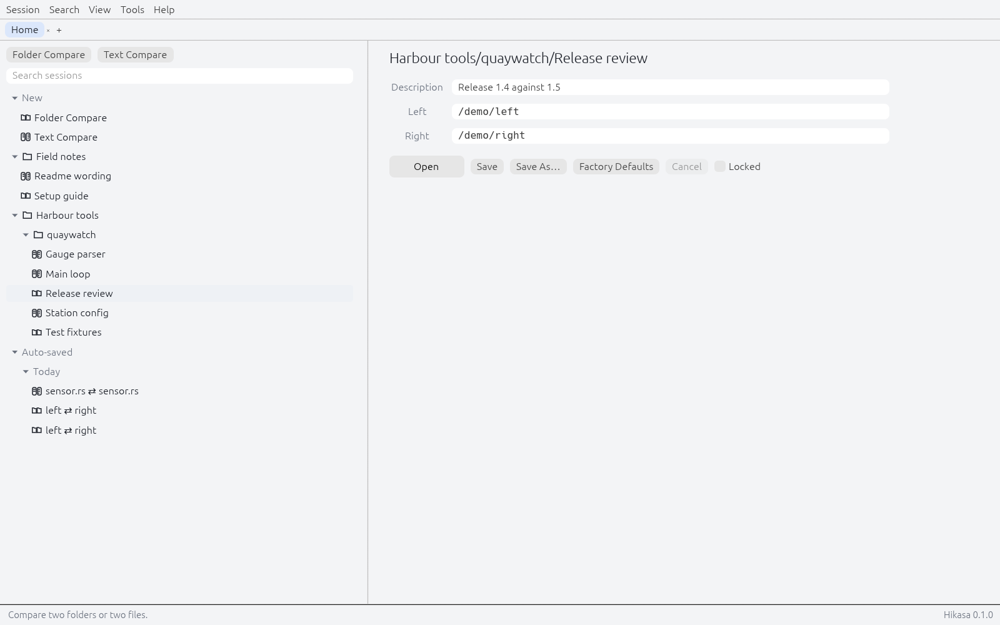
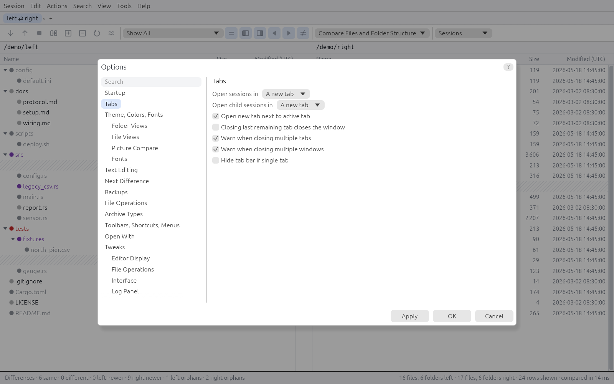
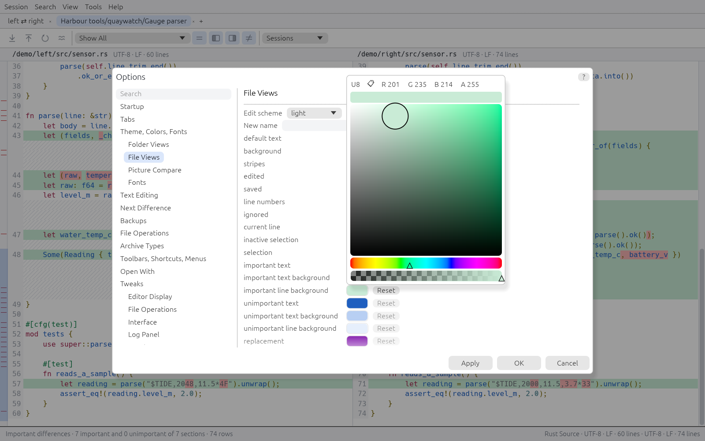
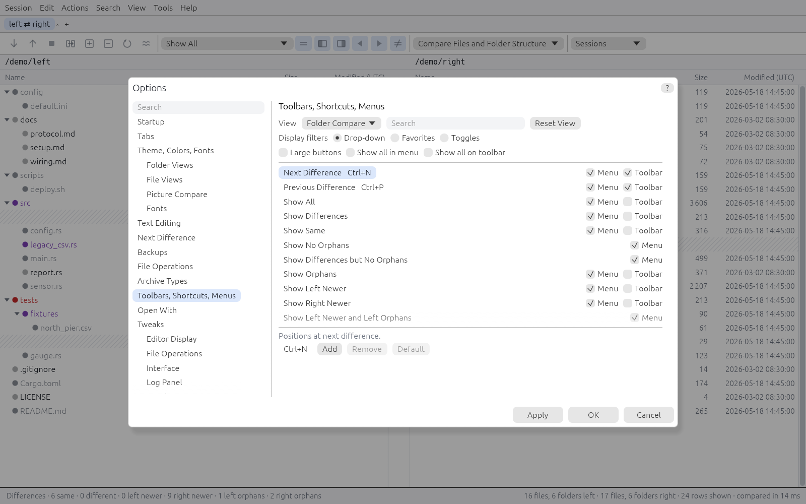
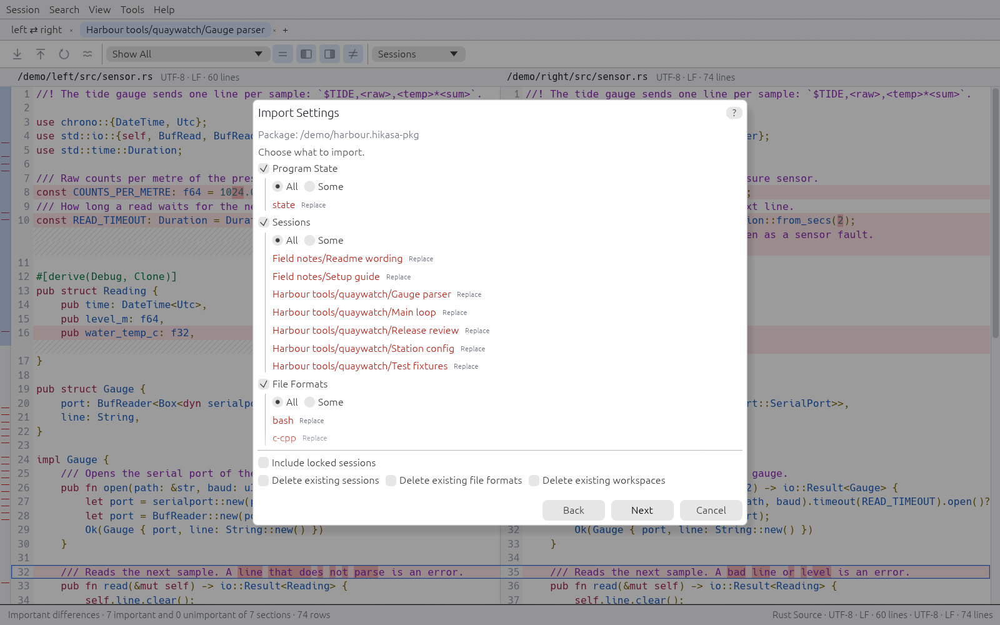
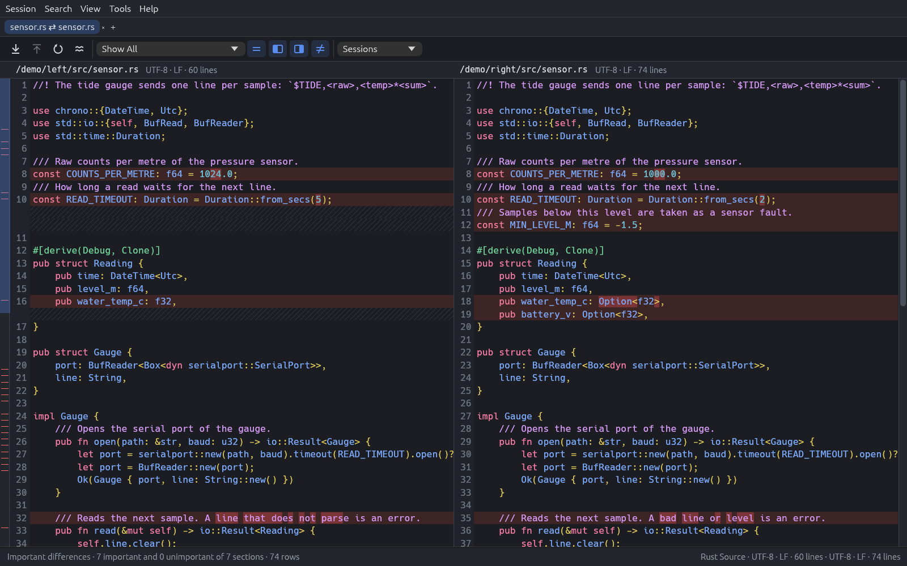
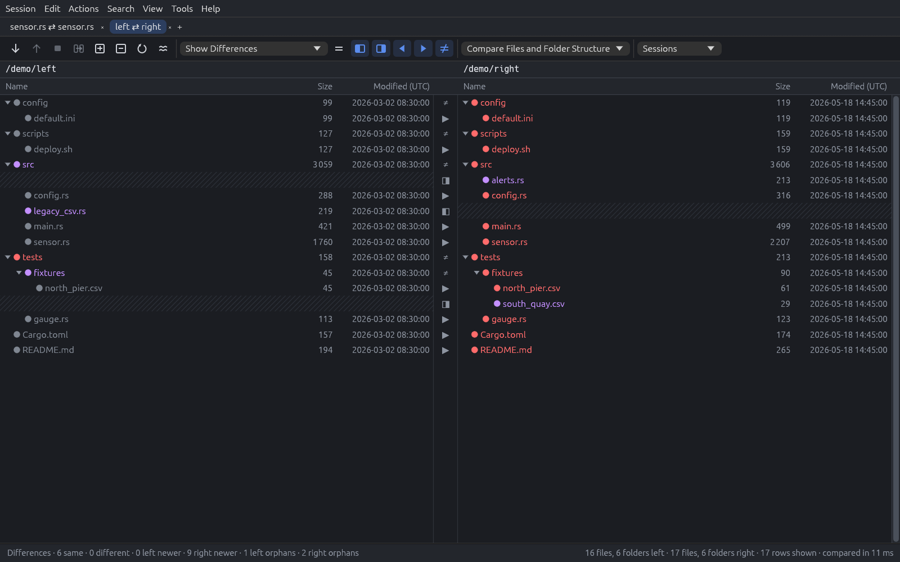

<p align="center">
  <picture>
    <source media="(prefers-color-scheme: dark)" srcset="assets/brand/logo-dark.svg">
    
  </picture>
</p>

<h1 align="center">Hikasa</h1>

<p align="center"><b>A folder and file compare tool for the desktop and the command line.</b></p>

<p align="center">
  Compare two folder trees or two text files, see what changed down to the character, keep the setup as a session
  and run it again from the window or from a script. Written in Rust, with an egui window and a <code>hikasa</code>
  command that does the same comparisons without one. Editing, merging and sync are not there yet: see
  <a href="#what-works-today">what works today</a>.
</p>

<p align="center">
  
  
  
  
</p>

<p align="center">
  
  <br>
  <sub>Text Compare: changed lines tinted, the changed characters marked inside them, gaps where one side has more lines, syntax colouring from the file format. Project-made demo data.</sub>
</p>

<p align="center">
  <a href="#screenshots">Screenshots</a> ·
  <a href="#why-hikasa">Why Hikasa</a> ·
  <a href="#what-works-today">What works today</a> ·
  <a href="#quick-start">Quick start</a> ·
  <a href="#architecture">Architecture</a> ·
  <a href="#roadmap">Roadmap</a> ·
  <a href="#downloads">Downloads</a> ·
  <a href="#license-and-credits">License and credits</a>
</p>

## Screenshots

<table>
  <tr>
    <td width="50%"><br><sub>Folder Compare: red is newer, grey is older, purple is on one side only, black is the same.</sub></td>
    <td width="50%"><br><sub>Home: sessions in folders, the auto-saved ones by day, the selected session ready to open.</sub></td>
  </tr>
  <tr>
    <td width="50%"><br><sub>Options: a searchable page tree over the settings files.</sub></td>
    <td width="50%"><br><sub>The theme editor changes the views as you pick: here the changed lines behind the dialog turn green.</sub></td>
  </tr>
  <tr>
    <td width="50%"><br><sub>Toolbars, Shortcuts, Menus: each view has its own commands and keys.</sub></td>
    <td width="50%"><br><sub>The Import wizard: choose what a settings package brings in, item by item.</sub></td>
  </tr>
  <tr>
    <td width="50%"><br><sub>The dark theme, on Text Compare.</sub></td>
    <td width="50%"><br><sub>The dark theme, on Folder Compare with only the differences shown.</sub></td>
  </tr>
</table>

## Why Hikasa

- **The command line comes first.** Every comparison is a `hikasa` subcommand before it is a view, with `--json` output and documented exit codes (1 or 2 same, 13 different, 12 only unimportant differences), so it fits scripts and CI jobs.
- **Differences that matter.** Each file format knows its grammar, so a rule can say what is unimportant: `--unimportant element:Comment` turns a changed comment into exit code 12 instead of 13. Whitespace, case, plain text and regular expressions work the same way. 21 file formats are built in, among them Rust, C and C++, Python, JavaScript, Java, SQL, HTML and XML.
- **Folders by your rules.** Compare by size, timestamps, permissions, CRC, byte by byte, or with the text rules, with name filters and display filters on top.
- **Built for big inputs.** Measured at 0.1.0 on one desktop (Ryzen 7 7800X3D, NVMe, Linux): a cold scan of 100,000 files per side, sizes and timestamps only, in 0.694 s, and a side-by-side view of two 1,000,000-line files that opens in 0.51 s and scrolls at the display's 120 Hz. Not yet measured on a 2020-class laptop.
- **Sessions keep your setup.** Named sessions in folders, auto-saved ones, locks, workspaces that restore windows and tabs, and settings packages that move all of it to another machine.
- **Plain settings.** TOML files you can read, change with `hikasa settings get|set` or in the Options dialog, and carry in a portable folder with `hikasa-portable.toml`.
- **Rust and open source only.** No proprietary SDK, open-source dependencies under a license policy that `cargo deny` checks ([`deny.toml`](deny.toml)).

## What works today

This page describes version 0.1.90, a pre-release of 0.2.0 with the first part of milestone M2 on top of 0.1.0 (M1); 0.2.0 stays reserved for M2 complete. Of the 15 waves of M2 ([plan](docs/design/m2-plan.md#2-waves)), W0–W4 are in this version and W5–W14 are not. In the [command catalogue](docs/reference/commands.md), 98 of 475 commands are implemented; the rest are planned and stay out of the menus.

| Area | Status |
|---|---|
| Text Compare: alignment (standard, Myers, histogram, patience), inline differences, syntax colouring, important and unimportant differences, display filters | Works in the window and on the command line; read-only so far (M1) |
| Folder Compare: parallel scan, rules, name and display filters, tree view, opening a file pair | Works in the window and on the command line; no file operations in the view yet (M1) |
| File formats: 21 built in, encoding detection, `hikasa format` for listing, editing and importing | Works from the command line; the File Formats dialog is planned (M1, W1) |
| Reports: plain text, side-by-side HTML, patches, summaries, statistics, JSON | Works from the command line; no report dialog yet (M1) |
| Settings store: typed TOML files with unknown keys kept, `hikasa settings` | Works; some options are stored now and only used by later waves (W1) |
| Sessions, auto-save, locks, session folders, workspaces, settings packages | Works, in the window and with `hikasa session`, `workspace` and `settings export\|import` (W2, W4) |
| File operations on the command line: `hikasa vfs cp\|mv\|rm\|mkdir\|touch`, with `--dry-run` | Works (W3) |
| Clipboard as an input: `clipboard://` | Works on the command line and in the window (W3) |
| Window: several windows, tabs, menus and shortcuts from the catalogue, status bar, log panel, notices, drag and drop, help on F1 | Works under Xvfb and in tests; tree dragging, shortcut capture and colour pickers still await a check on a real desktop (W4) |
| Options dialog, theme editor with live preview, Toolbars/Shortcuts/Menus page, Export, Import and Restore wizards | Works under Xvfb and in tests (W4) |
| Packages for Linux and Windows | Built from `packaging/` and smoke tested, see [Downloads](#downloads) |
| Archives (zip, tar) | Not yet (W5) |
| Folder operations and Folder Sync in the window | Not yet (W6, W9) |
| Script language | Not yet (W8); the crate is empty |
| Report dialog, XML reports | Not yet (W7, W13) |
| Text editing, find and replace, bookmarks | Not yet (W10, W11) |
| Table, Hex and Picture Compare | Not yet (W12, W13); the crates are empty |
| Text Merge, Folder Merge, remote back-ends, snapshots, media, version and registry views | Not yet (M3) |

CI was last green at 0.1.0, on Linux, Windows and macOS. At 0.1.90 the tests have run locally on Linux and, as Windows binaries, under wine, and the window only with software rendering. At the end of W4, peak memory while comparing two 1,000,000-line files was 419–429 MiB, above the 400 MB target, and the frame-rate run with a GPU is still open ([docs/02](docs/02-tech-stack.md)).

## Quick start

You need Rust 1.97 or newer and a C compiler. On Linux the window needs an X11 or Wayland session at run time; building needs no GUI development packages.

```sh
git clone --branch v0.1.90 https://github.com/KvasFan/Hikasa.git
cd Hikasa
cargo build --release
target/release/hikasa --help
```

Compare from the command line:

```sh
target/release/hikasa text compare left.txt right.txt
target/release/hikasa text compare a.rs b.rs --unimportant element:Comment
target/release/hikasa text compare a.rs b.rs --report side-by-side --html > diff.html
target/release/hikasa folder compare left/ right/ --json
target/release/hikasa help text compare
```

Compare in the window:

```sh
target/release/hikasa-gui                      # the window (Home)
target/release/hikasa-gui left/ right/         # or open a comparison directly
target/release/hikasa gui open a.txt b.txt --wait
```

Keep a comparison as a session, then run it with or without the window:

```sh
target/release/hikasa session mkdir review
target/release/hikasa session new --type text-compare --left a.txt --right b.txt review/notes
target/release/hikasa session run review/notes
target/release/hikasa gui session review/notes
```

The exit code is the verdict; [help/exit-codes.md](help/exit-codes.md) lists them all and [docs/12](docs/12-cli-and-scripting.md) covers the command line. `hikasa completions <shell>` prints completions for bash, zsh, fish, elvish and PowerShell.

Settings live in `~/.config/hikasa` (or `$XDG_CONFIG_HOME/hikasa`), `%APPDATA%\Hikasa` on Windows and `~/Library/Application Support/Hikasa` on macOS. A file named `hikasa-portable.toml` next to the executable keeps them in that folder instead.

## Architecture

A Cargo workspace in three layers. The **core** crates hold all the logic and no UI: `hikasa-core`, `-vfs` (file access), `-diff` (alignment), `-formats`, `-text`, `-folder`, `-report` and `-session` (the service the other two layers call). The crates `-table`, `-hex`, `-picture`, `-metadata` and `-script` are still empty. **`hikasa`** (`cli/hikasa-cli`) exposes every function headless and talks to a running window over IPC. **`hikasa-gui`** (`gui/hikasa-gui`, egui and eframe) is a thin front-end over the same core; a second launch forwards its arguments to the running one. See [docs/01](docs/01-architecture.md).

Linux comes first, then Windows and macOS.

| Document | Contents |
|---|---|
| [docs/00-overview.md](docs/00-overview.md) | Vocabulary, quality bar, requirement notation: start here |
| [docs/01-architecture.md](docs/01-architecture.md) | Layers, crates, IPC |
| [docs/02-tech-stack.md](docs/02-tech-stack.md) | Dependencies, the GUI toolkit evaluation, performance gates and measurements |
| [docs/03](docs/03-sessions-settings-profiles.md) … [docs/15](docs/15-options-reference.md) | One specification per area: folder, text, table, hex and picture views, formats, VFS, CLI, reports, UI, options |
| [docs/16-roadmap.md](docs/16-roadmap.md) | Milestones and what is done |
| [docs/17-agent-workflow.md](docs/17-agent-workflow.md) | The rules for human and AI contributors |
| [docs/design/](docs/design/m2-plan.md) | The M2 plan and the binding contracts of M1 and M2 |
| [docs/reference/commands.md](docs/reference/commands.md) | The command catalogue, generated |
| [help/](help/index.md) | The help topics of `hikasa help` and F1 |
| [packaging/README.md](packaging/README.md) | How the packages are built, and the release steps |
| [CHANGELOG.md](CHANGELOG.md) | What changed, wave by wave |

The specification comes first and is written as instructions for AI coding agents and human contributors; the implementation follows it wave by wave. To work on the code, read docs/00, 01, 02, 16 and 17 in that order, then the area specification and the command catalogue.

### Development

```sh
cargo install --locked cargo-nextest cargo-deny
```

| Command | What it does |
|---|---|
| `cargo build --release` | `target/release/hikasa` and `hikasa-gui` |
| `cargo fmt --all --check` | formatting |
| `cargo clippy --workspace --all-targets -- -D warnings` | lints |
| `cargo nextest run --workspace` | the tests |
| `cargo test --workspace --doc` | the doc tests |
| `cargo deny check` | licenses, advisories, bans and sources |
| `cargo xtask commands-doc [--check]` | writes `docs/reference/commands.md` from the catalogue, or fails when it is stale |
| `cargo xtask help-check` | every subcommand, view and dialog has a help topic, and every link resolves |
| `env -u WAYLAND_DISPLAY xvfb-run -a cargo test -p hikasa-gui --test cli_gui -- --ignored` | the tests that open a window, on a virtual X display |
| `packaging/build-all.sh` | every package into `target/dist/`, with `SHA256SUMS` |
| `packaging/smoke-test.sh` | tests the packages; nothing is installed on the system |

The screenshots on this page are real captures of `hikasa-gui` on a virtual display with software rendering; [`docs/images/make-demo.sh`](docs/images/make-demo.sh) generates the demo data and records how they were made.

## Roadmap

0.0.0 was the specification and 0.1.0 (M1) brought the core engines, the command line and the first window. M2, for 0.2.0, is the usable tool. 0.1.90 is its pre-release with W0–W4 done, and next come archives (W5), folder operations and the sync engine (W6), reports (W7), scripts (W8), Folder Compare and Sync in the window (W9), text editing (W10, W11), Table, Hex and Picture Compare (W12, W13) and release hardening (W14). M3, for 1.0, adds Text Merge and Folder Merge, Sync Memory, remote back-ends (FTP, SFTP, WebDAV, S3), snapshots, 7z, shell integration, accessibility and the user manual. After 1.0 come cloud drives, a plugin API and more archive types. The details are in [docs/16-roadmap.md](docs/16-roadmap.md).

## Downloads

Version 0.1.90 is a pre-release: the packages are on its [release page](https://github.com/KvasFan/Hikasa/releases/tag/v0.1.90), with `SHA256SUMS`. They are built by hand from [`packaging/`](packaging/README.md) on the maintainer's machine.

| Format | File | Status |
|---|---|---|
| Source | `cargo build --release` | See [Quick start](#quick-start) |
| Linux x86-64 `.tar.gz` | `hikasa-0.1.90-x86_64-linux.tar.gz` | Smoke tested |
| Linux x86-64 AppImage | `Hikasa-0.1.90-x86_64.AppImage` | Smoke tested; needs FUSE, or `--appimage-extract-and-run`; `--cli` reaches the command line |
| Debian and Ubuntu `.deb` (amd64) | `hikasa_0.1.90-1_amd64.deb` | Smoke tested |
| Arch Linux package | `hikasa-0.1.90-1-x86_64.pkg.tar.zst` | `packaging/aur/PKGBUILD` builds the tagged source; not on the AUR yet; linked against the system's glibc |
| Windows x64 MSI | `hikasa-0.1.90-windows-x64.msi` | Tested under wine only, not on real Windows |
| Windows x86 MSI | `hikasa-0.1.90-windows-x86.msi` | Tested under wine only, not on real Windows |
| Windows x64 portable zip | `hikasa-0.1.90-windows-x64-portable.zip` | Tested under wine only, not on real Windows; settings stay in the zip's folder |
| Windows x86 portable zip | `hikasa-0.1.90-windows-x86-portable.zip` | Tested under wine only, not on real Windows; settings stay in the zip's folder |

The `.tar.gz`, AppImage and `.deb` are linked against glibc 2.31 (the newest symbol they use is `GLIBC_2.30`), so they should run on distributions of that age, but they have not been run on one yet. The x86 `hikasa.exe` sometimes hangs at exit under wine (one run in 160 in a stress test), and the cause is not known yet. There is no macOS package.

## License and credits

Dual-licensed under [MIT](LICENSE-MIT) OR [Apache-2.0](LICENSE-APACHE), at your option. The logo and icons in `assets/brand/` are original works of the project.

Dependencies are open source under the licenses allowed in [`deny.toml`](deny.toml), mostly MIT and Apache-2.0, with the free font licenses of the fonts egui embeds. Every package carries `THIRD_PARTY_LICENSES.txt`, generated from the crates compiled into it. The interface is built with [egui and eframe](https://github.com/emilk/egui).
